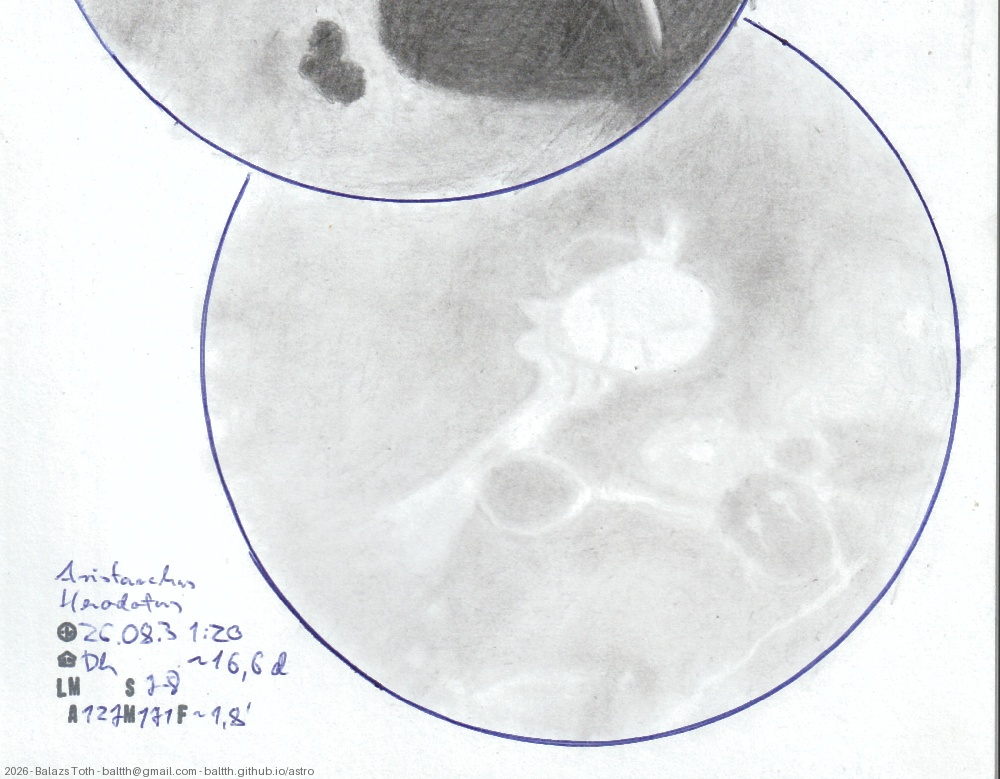

# Aristarchus, Herodotus

[Main page](../../index.md) -- [Index](../../pages/obj_index.md) -- [Previous: Aristarchus, Herodotus on 2025-09-06](../../obs/2025/aristarchus-herodotus-2025-09-06.md) -- [Next: Aristarchus, Herodotus on 2026-09-02](../../obs/2026/aristarchus-herodotus-2026-09-02.md)

_Aristarchus_ -- _Crater in Moon_  
_Herodotus_ -- _Crater in Moon_  

Last year I've created two drawing of these at the age of 12 and 14 days.
Now I had the idea to make a series to explore how it evolves. To be continued.

Objects | Aristarchus, Herodotus
-|-
Observed at | Dunaharaszti, HU, 2026-08-30 01:20
Seeing | 7-8
Aperture | 127 mm
Magnification | 171x
FOV | ~200 km
**Other data** |  
Age of Moon | 16.6 days

#### Object data

Objects | Aristarchus | Herodotus
-|-|-
Desc. | Crater | Crater
Coordinates | 23.7°N 47.4°W | 23.2°N 49.7°W
Size | 40 km | 35 km

## Links

- [Full sketch](../../img/2026/hommel-pitiscus-aristarchus-herodotus-20260929.jpg)
- [Original sketch](../../scan/2026/20260907003522_001.jpg)
- [Previous: Aristarchus, Herodotus on 2025-09-06](../../obs/2025/aristarchus-herodotus-2025-09-06.md)
- [Next: Aristarchus, Herodotus on 2026-09-02](../../obs/2026/aristarchus-herodotus-2026-09-02.md)
