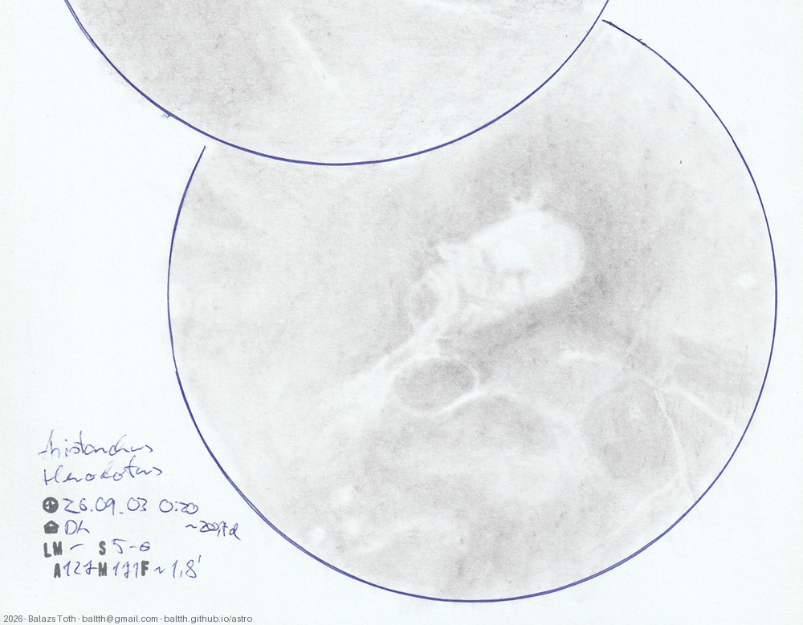

# Aristarchus, Herodotus

[Main page](../../index.md) -- [Index](../../pages/obj_index.md) -- [Previous: Aristarchus, Herodotus on 2026-08-29](../../obs/2026/aristarchus-herodotus-2026-08-29.md)

_Aristarchus_ -- _Crater in Moon_  
_Herodotus_ -- _Crater in Moon_  

Fifth part of the Aristarchus series (20th day). Now that I've added two to the original ones from 2025,
I'm pretty sure that I have to redraw the old ones.

Objects | Aristarchus, Herodotus
-|-
Observed at | Dunaharaszti, HU, 2026-09-03 00:20
Seeing | 5-6
Aperture | 127 mm
Magnification | 171x
FOV | ~200 km
**Other data** |  
Age of Moon | 20.7 days

#### Object data

Objects | Aristarchus | Herodotus
-|-|-
Desc. | Crater | Crater
Coordinates | 23.7°N 47.4°W | 23.2°N 49.7°W
Size | 40 km | 35 km

## Links

- [Full sketch](../../img/2026/vendelinus-lame-holden-aristarchus-herodotus-20260929.jpg)
- [Original sketch](../../scan/2026/20260929004022_001.jpg)
- [Previous: Aristarchus, Herodotus on 2026-08-29](../../obs/2026/aristarchus-herodotus-2026-08-29.md)
