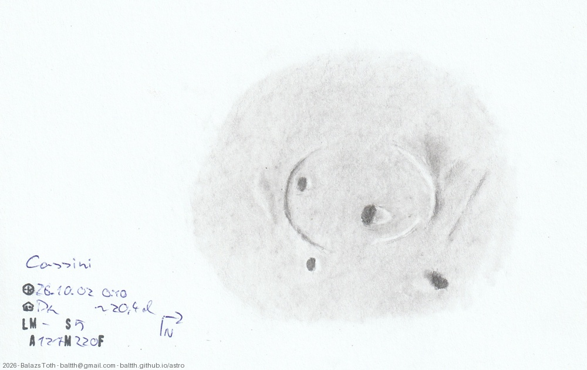

# Cassini

[Main page](../../index.md) -- [Index](../../pages/obj_index.md)

_Cassini_ -- _Crater in Moon_  

Object | Cassini
-|-
Observed at | Dunaharaszti, HU, 2026-10-02 00:10
Seeing | 5
Aperture | 127 mm
Magnification | 220x
FOV | ~110 km
**Other data** |  
Age of Moon | 20.4 days

#### Object data

Object | Cassini
-|-
Desc. | Crater
Coordinates | 40.25°N 4.64°E
Size | 57 km

## Links

- [Full sketch](../../img/2026/leakey-censorinus-n-lubbock-n-cassini-20261013.jpg)
- [Original sketch](../../scan/2026/20261005023025_001.jpg)
