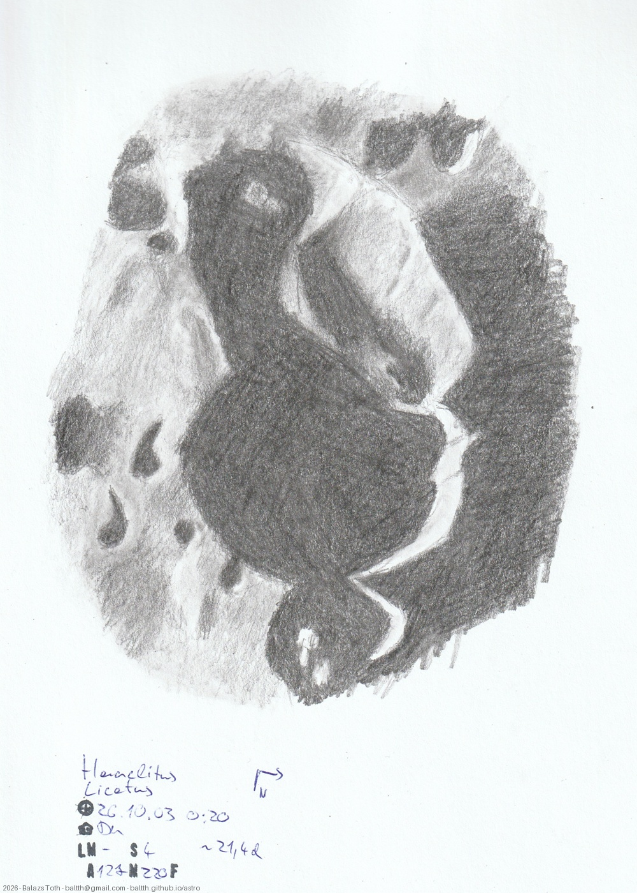

# Heraclitus, Licetus

[Main page](../../index.md) -- [Index](../../pages/obj_index.md)

_Heraclitus_ -- _Crater in Moon_  
_Licetus_ -- _Crater in Moon_  

Objects | Heraclitus, Licetus
-|-
Observed at | Dunaharaszti, HU, 2026-10-03 00:20
Seeing | 4
Aperture | 127 mm
Magnification | 220x
FOV | ~200 km
**Other data** |  
Age of Moon | 21.4 days

#### Object data

Objects | Heraclitus | Licetus
-|-|-
Desc. | Crater | Crater
Coordinates | 49.2°S 6.2°E | 47.1°S 6.7°E
Size | 90 km | 75 km

## Links

- [Full sketch](../../img/2026/heraclitus-licetus-na-20261013.jpg)
- [Original sketch](../../scan/2026/20261005023143_001.jpg)
