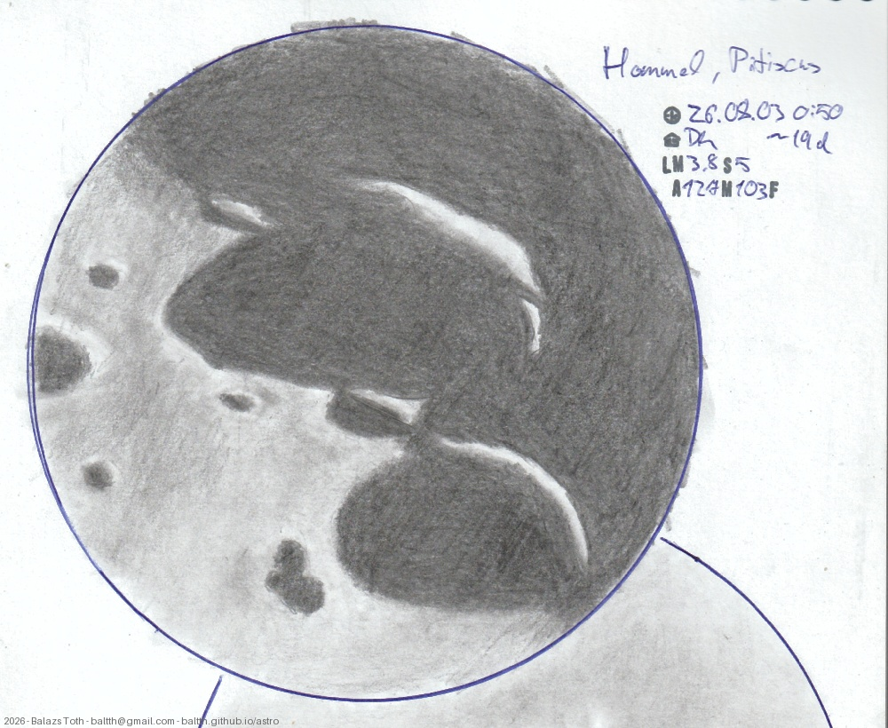

# Hommel, Pitiscus

[Main page](../../index.md) -- [Index](../../pages/obj_index.md)

_Hommel_ -- _Crater in Moon_  
_Pitiscus_ -- _Crater in Moon_  

Objects | Hommel, Pitiscus
-|-
Observed at | Dunaharaszti, HU, 2026-08-03 00:50
NELM | ~ 3.8
Seeing | 5
Aperture | 127 mm
Magnification | 103x
FOV | ~220 km
**Other data** |  
Age of Moon | 19 days

#### Object data

Objects | Hommel | Pitiscus
-|-|-
Desc. | Crater | Crater
Coordinates | 54.6°S 33.0°E | 50.61°S 30.57°E
Size | 120 km | 80 km

## Links

- [Full sketch](../../img/2026/hommel-pitiscus-aristarchus-herodotus-20260929.jpg)
- [Original sketch](../../scan/2026/20260907003522_001.jpg)
