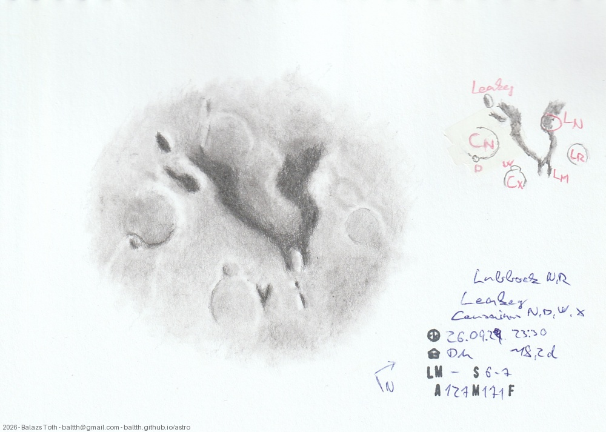

# Leakey, Censorinus N, Lubbock N

[Main page](../../index.md) -- [Index](../../pages/obj_index.md)

_Leakey_ -- _Crater in Moon_  
_Censorinus N_ -- _Crater in Moon_  
_Lubbock N_ -- _Crater in Moon_  

A squirrel-tailed dog catching the frisbee... 

Objects | Leakey, Censorinus N, Lubbock N
-|-
Observed at | Dunaharaszti, HU, 2026-09-29 23:30
Seeing | 6-7
Aperture | 127 mm
Magnification | 171x
FOV | ~200 km
**Other data** |  
Age of Moon | 18.2 days

#### Object data

Objects | Leakey | Censorinus N | Lubbock N
-|-|-|-
Desc. | Crater | Crater | Crater
Coordinates | 3.2°S 37.4°E | 1.9°S 36.5°E | 1.5°S 39.7°E
Size | 12 km | 36 km | 26 km

## Links

- [Full sketch](../../img/2026/leakey-censorinus-n-lubbock-n-cassini-20261013.jpg)
- [Original sketch](../../scan/2026/20261005023025_001.jpg)
