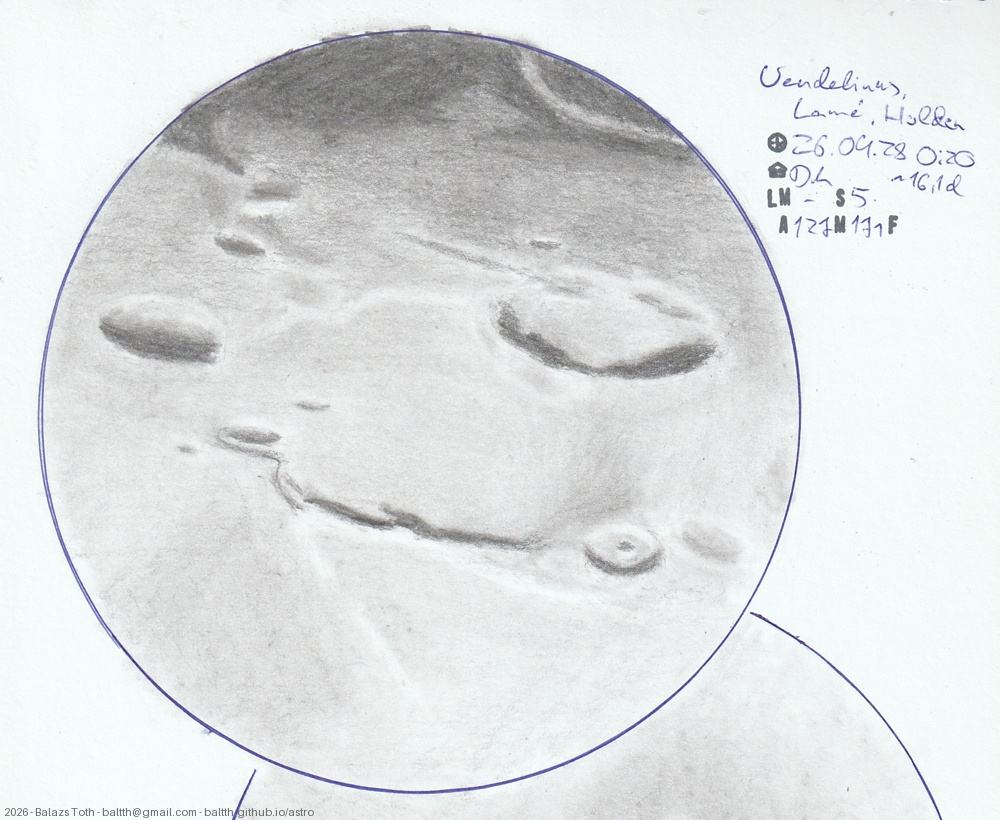

# Vendelinus, Lamé, Holden

[Main page](../../index.md) -- [Index](../../pages/obj_index.md)

_Vendelinus_ -- _Crater in Moon_  
_Lamé_ -- _Crater in Moon_  
_Holden_ -- _Crater in Moon_  

Objects | Vendelinus, Lamé, Holden
-|-
Observed at | Dunaharaszti, HU, 2026-09-28 00:20
Seeing | 5
Aperture | 127 mm
Magnification | 171x
FOV | ~280 km
**Other data** |  
Age of Moon | 16.1 days

#### Object data

Objects | Vendelinus | Lamé | Holden
-|-|-|-
Desc. | Crater | Crater | Crater
Coordinates | 16.46°S 61.55°E | 14.7°S 64.5°E | 19.19°S 62.53°E
Size | 147 km | 84 km | 48 km

## Links

- [Full sketch](../../img/2026/vendelinus-lame-holden-aristarchus-herodotus-20260929.jpg)
- [Original sketch](../../scan/2026/20260929004022_001.jpg)
